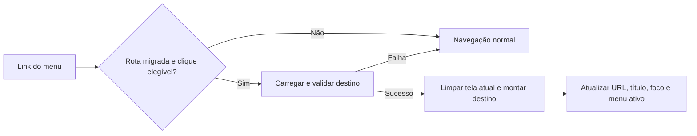

# Navegação sem recarregamento completo no Sementis

**Data:** 02/11/2026.  
**Status:** diagnóstico e proposta de implementação. A navegação descrita como solução ainda não foi implementada.

## Problema observado

Ao selecionar uma área do menu, o Sementis inicia uma navegação de documento completo. O navegador mostra o carregamento e recria a interface, mesmo quando a barra lateral e parte do visual são iguais entre as telas.

O comportamento desejado é trocar a área principal e atualizar o endereço mantendo a estrutura do aplicativo aberta. O Duolingo foi citado como referência dessa experiência; este documento não afirma qual tecnologia ou implementação interna ele utiliza.

As correções de imagens, proporções, animações e sombras melhoram a renderização das telas atuais. Elas não modificam o mecanismo de navegação e, portanto, não eliminam a abertura de outro documento HTML.

## Causa no repositório

O projeto usa uma arquitetura multipágina com Flask e HTML/CSS/JavaScript puro:

- [`../js/shared-navbar.js`](../js/shared-navbar.js) monta links reais como `href="home.html"`, `href="missions.html"` e `href="ligas.html"`. O clique nesses links segue a navegação padrão do navegador.
- A navbar compartilhada é reutilizada como código, mas sua instância no DOM é criada novamente em cada documento. Compartilhar um arquivo JavaScript não torna o elemento persistente entre páginas.
- O prefetch existente antecipa o HTML quando há intenção de navegar. Ele pode reduzir a espera de rede, mas continua abrindo outro documento.
- [`../app.py`](../app.py) serve os arquivos HTML pelas rotas existentes. Cada página funciona como ponto de entrada independente.
- [`../js/home.js`](../js/home.js), [`../js/missoes.js`](../js/missoes.js) e [`../js/ligas.js`](../js/ligas.js) inicializam comportamentos por `DOMContentLoaded`.
- [`../js/passe-batalha.js`](../js/passe-batalha.js) também possui inicialização própria, estado local, observers e listeners. Atualmente o descarte do documento encerra naturalmente muitos desses recursos.

O navegador pode reutilizar imagens, CSS e scripts em cache; isso não significa necessariamente baixar todos os arquivos novamente. Ainda assim, o documento de destino precisa ser criado e seus scripts executados. A navegação sem recarregamento precisa mudar essa relação.

## Solução recomendada

Adotar navegação interna progressiva, mantendo Flask, Vanilla JS, URLs existentes e links nativos como alternativa. Começar por Trilhas (`home.html`), Missões e Ligas. Professor, autenticação, partidas ao vivo e engines de minigames ficam fora do primeiro piloto.

Uma estrutura persistente deve conter a navbar e o espaço da tela ativa. Elementos comuns só devem entrar nessa estrutura quando seus contratos e estilos forem realmente compartilhados; os cabeçalhos atuais não precisam ser todos unificados no primeiro passo.

### 1. Roteador pequeno com rotas explícitas

Criar um registro das telas migradas, com URL, carregamento de conteúdo, estilos necessários e funções de inicialização/limpeza. Os nomes de arquivos novos deverão seguir o padrão do projeto; não há implementação de roteador neste documento.

Interceptar somente cliques primários, sem teclas modificadoras, em links da mesma origem e de rotas já migradas. Preservar Ctrl/Cmd+clique, Shift+clique, botão do meio, `target`, downloads, links externos e destinos ainda não migrados. Atributos `href` continuam funcionando sem o roteador.

O destino pode inicialmente ser carregado a partir do HTML existente e ter seu conteúdo validado e extraído por `DOMParser`. Usar um seletor explícito por rota, pois as telas têm estruturas diferentes. Não inserir o documento inteiro dentro de outro `body`, nem duplicar a navbar.

Tratar os arquivos de aplicação como conteúdo controlado do projeto. Não transformar o roteador em um mecanismo para buscar HTML arbitrário ou executar texto recebido por `eval`.

### 2. Histórico, URLs e acesso direto

Usar `pushState` para criar entradas de navegação interna e `replaceState` para preparar o estado inicial. Implementar `popstate` para restaurar a tela correta ao voltar/avançar, sem criar uma nova entrada nesse processo. Esses métodos atualizam o histórico; renderizar o destino continua sendo responsabilidade da aplicação. [Referência: History API, MDN](https://developer.mozilla.org/en-US/docs/Web/API/History_API/Working_with_the_History_API).

Manter as URLs `.html` existentes no piloto reduz a necessidade de mudanças no servidor: atualizar a página, abrir uma aba nova ou acessar um favorito continua carregando o HTML completo atual e inicializando a tela correspondente.

Não criar neste primeiro passo um fallback genérico que devolva o mesmo HTML para qualquer caminho. Isso pode confundir erros de API, imagens e arquivos ausentes com uma resposta de página válida.

Preservar query strings relevantes, como `module`, e fragmentos que fazem parte da navegação. Definir a restauração de scroll: nova área normalmente começa no topo; voltar/avançar restaura a posição anterior. Se o roteador assumir essa tarefa, coordenar com `history.scrollRestoration` para evitar duas restaurações concorrentes.

### 3. Ciclo de vida das telas

Este é o principal trabalho da migração. `DOMContentLoaded` ocorre no carregamento inicial do documento, não a cada substituição de conteúdo.

Cada tela migrada precisa de funções explícitas, por exemplo `inicializarTela(contexto)` e `limparTela()`. Elas devem funcionar tanto na entrada direta pelo HTML quanto na entrada pelo roteador. Definir uma única autoridade de montagem para evitar executar os dois caminhos simultaneamente.

| Recurso da tela | Responsabilidade ao sair |
| --- | --- |
| Eventos em `document`, `window` ou body | Remover os listeners registrados pela tela |
| Timers e trabalho agendado | Cancelar intervalos, timeouts e callbacks pendentes |
| Intersection/Mutation observers | Desconectar e liberar referências ao DOM antigo |
| Fetch em andamento | Cancelar quando possível e ignorar respostas de telas antigas |
| Vídeos e áudio | Pausar mídia da tela que saiu |
| Modais e overlays | Fechar e remover bloqueios de scroll/foco pertencentes à tela |
| Estado global e variáveis de módulo | Limpar referências antigas e definir o que deve persistir |

O cancelamento de requisições pode usar `AbortController`, conforme a [referência MDN](https://developer.mozilla.org/en-US/docs/Web/API/AbortController). Além disso, usar uma identificação de navegação para impedir que uma resposta antiga substitua uma tela mais recente.

Não tentar simular uma nova navegação disparando `DOMContentLoaded` manualmente. Isso reinicializaria também os componentes globais. Não reinjetar todos os scripts a cada clique: listeners duplicados e declarações globais conflitantes são riscos concretos.

Auditar handlers inline e funções globais existentes, como abrir/fechar o passe. Durante a migração, manter essas interfaces compatíveis ou adaptá-las explicitamente; substituir apenas o HTML pode deixar controles chamando funções de uma tela anterior.

### 4. CSS e estrutura persistente

As telas usam classes do body, seletores genéricos e layouts próprios. Carregar todos os CSS juntos sem revisão pode alterar a aparência de outras áreas.

- Manter tokens e navbar compartilhados em suas folhas atuais.
- Definir classes de contexto por tela e aplicá-las/removê-las na troca de rota.
- Revisar seletores genéricos antes de manter uma folha carregada junto às demais.
- Carregar os estilos necessários antes de mostrar o destino, evitando conteúdo sem estilo. Remover estilos específicos antigos somente quando for seguro para os elementos persistentes.
- Preservar a identidade visual, medidas, imagens, hover verde e correções já realizadas.

Na navbar persistente, atualizar a seção ativa e `aria-current` em cada troca. O código atual calcula a seção na montagem e possui uma marca que evita montagem duplicada; isso precisará ser adaptado para atualizar o estado sem reconstruir o menu.

### 5. Carregamento, concorrência e falhas

Preparar e validar o destino antes de desmontar a tela atual. Manter a interface disponível durante a espera, com feedback discreto e sem impor duração mínima ou animação obrigatória antes de navegar.

No sucesso, limpar a tela antiga, montar o conteúdo preparado, inicializar a nova tela e confirmar histórico/menu/título de forma coerente. Se a montagem ou inicialização falhar, permitir recuperação pelo endereço real do destino, evitando uma área principal vazia.

Em cliques rápidos A → B → C, somente a última navegação válida pode assumir a interface. Tratar respostas fora de ordem, requisições canceladas e falhas de rede. Uma navegação causada por `popstate` não deve chamar `pushState` novamente.

Não descartar caches de progresso existentes. Revalidar os dados mutáveis pelo fluxo já estabelecido das APIs. Autenticação, permissões, saldo, XP e recompensas continuam sendo responsabilidade dos contratos atuais; a migração não deve introduzir novas regras de negócio no frontend.

### 6. Acessibilidade e comportamento do navegador

- Atualizar `document.title` e o título principal da tela.
- Mover o foco para uma região apropriada da nova tela, sem prender o teclado na navbar nem deixar o foco num nó removido.
- Garantir recuperação de foco e scroll ao fechar modais.
- Respeitar movimento reduzido e disponibilizar controles sem depender de animações.
- Preservar abrir em outra aba, copiar link, atualizar, histórico e URLs compartilháveis.

## Migração em etapas

| Etapa | Entrega verificável |
| --- | --- |
| 1. Inventário e referência | Mapear scripts, estilos, eventos globais, timers, observers, mídia e URLs de Trilhas/Missões/Ligas; registrar desempenho atual |
| 2. Ciclo de vida | Adaptar uma tela e comprovar inicialização/limpeza sem quebrar sua entrada direta |
| 3. Piloto com duas rotas | Estrutura persistente, histórico e fallback funcionando entre Trilhas e Missões |
| 4. Ligas e dados compartilhados | Incluir Ligas, conferir autenticação, caches e atualização das informações comuns |
| 5. Expansão | Migrar outras áreas somente após o piloto cumprir os critérios; avaliar professor e jogos separadamente |

Usar a allowlist do roteador como limite do piloto: uma rota removida dessa lista volta a seguir o link nativo. Isso permite recuar sem reverter toda a aplicação. Os HTMLs atuais devem continuar disponíveis durante a migração.

O esforço é de complexidade média para alta. A estimativa preliminar de alguns dias depende do inventário e da validação dos ciclos de vida; não é um prazo fechado. Escrever `pushState` é uma parte pequena do trabalho. Estilos, limpeza de recursos e compatibilidade das telas concentram o risco.

## Critérios de aceite

- Navegar entre rotas migradas não cria um novo documento. No Network, pode haver fetch de HTML/dados, mas não uma nova navegação principal para cada clique.
- A navbar mantém a mesma instância no DOM, com item ativo atualizado.
- Não há conteúdo piscando por recarregamento da estrutura, menus duplicados ou animações de entrada reiniciadas indevidamente.
- Voltar/avançar, atualizar, abrir link diretamente e abrir em nova aba continuam corretos, inclusive com query string.
- Repetir o percurso de ida e volta pelo menos 20 vezes não multiplica handlers, ações, timers, observers ou requisições por interação.
- Requisição lenta, falha de recurso, token expirado e cliques repetidos resultam em estados recuperáveis; respostas antigas não trocam a tela atual.
- Coleta do passe, modal XP, progresso, mídia, sons e caches continuam corretos. Vídeos e decoração de telas inativas permanecem pausados.
- Comparações visuais em 320, 768, 1024 e 1440 px preservam o layout. Testar Firefox, outro navegador e aparelho físico quando disponível.
- Medir clique até conteúdo utilizável, tarefas longas e intervalos entre quadros nas mesmas condições de cache/rede antes e depois. Não aceitar a ausência do indicador de reload como única evidência de fluidez.
- Não há novos erros de console nem recursos de telas antigas retidos indefinidamente após os percursos repetidos.

## Relação com correções anteriores

- [Salto de layout e palavras no lugar de imagens](correcao-salto-imagens.md): reserva de proporção e tratamento visual do fallback dos PNGs.
- [Travamento de scroll no passe](correcao-scroll-passe.md): sombras reutilizadas e pausa de decoração invisível.

Essas correções devem ser preservadas. Navegação interna evita recriar o documento, mas não elimina por si só custos de pintura, consultas lentas ou trabalho excessivo de uma tela.

Este documento registra o problema e a abordagem proposta. Nenhum roteador, novo endpoint ou migração de tela foi implementado como parte da documentação.
