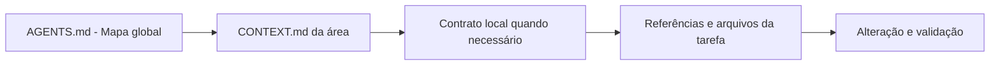

# Guia de Contribuição e Execução Local 🚀

Este guia é voltado para desenvolvedores, professores ou membros da comunidade acadêmica que desejam clonar o repositório, executar a aplicação localmente e contribuir com novas funcionalidades ou trilhas pedagógicas.

---

## 💻 Como Rodar o Projeto Localmente

Como a aplicação possui uma arquitetura desacoplada, o processo envolve iniciar o servidor da API (Python/Flask) e servir a interface web (Front-end).

### 1. Pré-requisitos
* **Python 3.10 ou superior** instalado.
* **Git** instalado.
* **VS Code** (recomendado, com a extensão **Live Server**).

---

### 2. Passo a Passo: Back-end (API)

1. Clone o repositório em sua máquina:
   ```bash
   git clone https://github.com/PHenrique07/Sementis-IFSP-Pirituba.git
   cd Sementis-IFSP-Pirituba
   ```

2. Crie e ative o ambiente virtual:
   * **Windows (PowerShell):**
     ```powershell
     python -m venv venv
     .\venv\Scripts\Activate.ps1
     ```
   * **Linux / macOS:**
     ```bash
     python3 -m venv venv
     source venv/bin/activate
     ```

3. Instale as dependências:
   ```bash
   pip install -r requirements.txt
   ```

4. Crie e popule o banco de dados inicial com dados de teste:
   ```bash
   python seeds.py
   ```
   *(Use no ambiente de desenvolvimento. O comando inicializa o esquema e o povoamento; se já houver usuário, interrompe o povoamento para evitar duplicatas. Para atualizar currículo existente, leia `backend/dados/CONTEXT.md` antes de usar `--atualizar-conteudo`.)*

5. Inicie o servidor Flask:
   ```bash
   python app.py
   # ou
   flask run
   ```
   *A API estará acessível em: `http://127.0.0.1:5000`.*

---

### 3. Passo a Passo: Front-end (Cliente)

1. Com o servidor Flask rodando no terminal, abra a pasta do projeto no VS Code.
2. Localize o arquivo `frontend/index.html`. As páginas, scripts, estilos e assets ficam juntos em `frontend/`.
3. Sirva `frontend/` como raiz pública em uma origem permitida pelo CORS de `backend/app.py`, como `http://localhost:3000`: configure a raiz/porta do Live Server ou use `python -m http.server 3000 --directory frontend` a partir da raiz do repositório em outro terminal. A porta padrão 5500 não está na lista atual de origens.
4. O arquivo [`js/api-config.js`](https://github.com/PHenrique07/Sementis-IFSP-Pirituba/blob/main/frontend/js/api-config.js) detecta `localhost`/`127.0.0.1` e aponta para a API local na porta 5000.

---

## 🛡️ Convenções e Regras Inegociáveis do Projeto

Para manter a consistência e a facilidade de manutenção por qualquer membro da equipe, todo o código do repositório deve respeitar as seguintes regras:

1. **Mimetismo de Código (Não invente):**
   Siga estritamente os padrões existentes no repositório. Não adicione bibliotecas pesadas de terceiros (Tailwind, React, Redux) nem mude a estrutura estabelecida.
2. **Modelagem via SQLModel:**
   Qualquer alteração estrutural no banco de dados DEVE ser feita adicionando ou modificando classes no [`models.py`](https://github.com/PHenrique07/Sementis-IFSP-Pirituba/blob/main/backend/models.py). Não execute comandos SQL manuais (*raw SQL*).
3. **Separação Rígida de Responsabilidades:**
   O front-end **nunca** calcula saldo de moedas, promoção de ligas ou ofensiva. O front envia a ação via API, o back-end processa e valida as regras de negócio, e o front apenas exibe o retorno.
4. **Nomenclatura em Português:**
   Variáveis, métodos e comentários de regras de negócio devem ser escritos prioritariamente em Português (ex: `atualizar_ofensiva`, `buscar_ranking_por_liga`, `concluir_atividade`).

---

## 🤖 Contexto para agentes e perfis do esquadrão

O ponto de entrada é o [AGENTS.md do repositório](https://github.com/PHenrique07/Sementis-IFSP-Pirituba/blob/main/AGENTS.md), que encaminha a tarefa aos contextos da área:



Um mesmo agente pode pesquisar, planejar, implementar e revisar. Os contextos de `backend/`, `frontend/` e `tests/` orientam cada área. Os perfis **SemeIA** (execução de ponta a ponta), **BrinIA** (pesquisa), **CaIA** (planejamento), **GratIA** (implementação) e **XimbeIA** (revisão) continuam disponíveis; trabalhar em vários arquivos não obriga chamar todo o esquadrão.

Antes de alterar um modelo, explicite impacto e compatibilidade dos dados. Antes de concluir, confira as invariantes da área e a [validação por escopo](https://github.com/PHenrique07/Sementis-IFSP-Pirituba/blob/main/docs/referencias/validacao.md). A suíte automatizada usa bancos isolados; scripts manuais podem acessar o banco local.

A [metodologia de contexto](https://github.com/PHenrique07/Sementis-IFSP-Pirituba/blob/main/docs/metodologia-contexto.md) explica a organização e sua referência no artigo da Building CERC.
